# รายงานวิจัยฉบับสมบูรณ์: ถอดรหัสเทคนิคแชมป์อันดับ 1 จาก 45+ การแข่งขัน Kaggle (ชนะเฉือน `< 0.0001–0.001`) และการประยุกต์ใช้กับทั้ง 5 Tasks

> [!IMPORTANT]
> **สรุปผลการสืบค้นและทดสอบเชิงประจักษ์จาก 5 `DeepInvestigator` Subagents**
> - สืบค้นเจาะลึก **45 กรณีศึกษาผู้ชนะอันดับ 1 บน Kaggle** ที่เฉือนชนะอันดับ 2 ด้วยแต้มทศนิยมตำแหน่งที่ 4–5 (`0.00001` ถึง `0.0010`)
> - นำทุกเทคนิคมา **ตรวจสอบกับโค้ดและข้อมูลจริงของทั้ง 5 Tasks (`t1`–`t5`)** เพื่อแยกแยะว่าเทคนิคใด **(A) ถูกนำมาใช้และพิสูจน์ผลแล้ว**, **(B) สามารถอัปเกรดเพิ่มคะแนน/ความเสถียรได้จริงตอนนี้**, และ **(C) ทดสอบแล้วพบว่าไม่ช่วยหรือทำให้คะแนนลดลง (ต้องหลีกเลี่ยง)**

---

## 1. ภาพรวมการจับคู่เทคนิคแชมป์ Kaggle สู่ทั้ง 5 Tasks

```mermaid
flowchart TD
    subgraph T1["Task 1: Anti-Cheat (Binary F2)"]
        K1["Amex (0.0004) / Porto Seguro / TPS Sep 2021 (0.00005) / SIIM-ISIC"]
        A1["ใช้แล้ว: MCAR Masking Aug (4x) + Two-Stage LogLoss -> Prob Cut p>=0.188 (60.0% test rate)\nข้อค้นพบสำคัญ: ห้ามใช้ Hard Zone Overrides (Nested CV ติดลบ -0.00038 เพราะสร้าง 22 FN)"]
        K1 --> A1
    end
    subgraph T2["Task 2: Player Segment (4-Class Macro-F1)"]
        K2["TPS Feb 2022 (0.00001) / Costa Rican Poverty / Santander / Otto / Cassava"]
        A2["Leak Track (sub_v16a): ID-Block Rule (0.9698 LB ชนเพดาน 3% Noise)\nClean Track Upgrade: 0.87 EM-NB + 0.08 Spline + 0.05 MLP + Affine Macro-F1 Rule (+0.00088 บน 15-Fold Nested CV, ยังไม่ได้ใส่ใน sub_v16b!)"]
        K2 --> A2
    end
    subgraph T3["Task 3: Spending Regression (NMAE)"]
        K3["Google Analytics LTV / Allstate (Fair & LAD) / M5 Uncertainty / Optiver"]
        A3["ใช้แล้ว: Two-Stage Hurdle Median q = 1 - 1/(2p) + CatBoost d4 MultiQuantile บน Log-Offset (0.7953 CV / 0.7950 LB)\nข้อค้นพบใหม่: seasonal_spending_pattern (เดือน 0..11) พุ่ง +25% ใน ธ.ค.(11)-ม.ค.(0) ใช้ Fourier sin/cos ช่วยรวบกิ่ง Tree"]
        K3 --> A3
    end
    subgraph T4["Task 4: Game Screenshots (5-Class Macro-F1)"]
        K4["Cassava (0.0003) / ISIC 2024 (EVA02 MIM) / GUIE & APTOS (GeM) / HPA (Focal) / Hotel-ID"]
        A4["พร้อมรันบน GPU: Ensemble ConvNeXt-Tiny + EVA02-Small MIM (task4-v4-eva02s) + GeM Pooling + Down/Upsample Aug\nข้อควรระวัง: ห้ามใช้ Expected-F1 Shift (แพ้ Argmax 100/100 รอบ) และระวัง HFlip TTA เพราะ HUD เกมไม่สมมาตร"]
        K4 --> A4
    end
    subgraph T5["Task 5: Account Anomaly (Unsupervised Binary F3)"]
        K5["Santander / TPS Feb & May 2022 / IEEE-CIS Fraud / Great Barrier Reef (F-beta)"]
        A5["Leak Track (sub_v16a): player_id >= P023819 (F3 = 1.0000)\nClean Track Upgrade: Subspace Tail Co-occurrence Box + Refined LLR บน behavior_stability=NaN ลด FP ลง 11 แถว (F3: 0.99696 -> 0.99749)"]
        K5 --> A5
    end
```

---

## 2. เจาะลึกราย Task: กรณีศึกษาแชมป์ Kaggle + ผลทดสอบจริงบนข้อมูลของเรา

### Task 1 — Anti-Cheat Detection (Binary Classification, Binary $F_2$)
*รายงานฉบับเต็มจาก [Task 1 Kaggle 1st-Place Investigator](conversation://56e14af1-f743-447f-82b9-82f3395a3eb1)*

#### 9 การแข่งขัน Kaggle ต้นแบบที่ศึกษา
| # | การแข่งขัน Kaggle | ช่องว่างอันดับ 1 vs 2 | เทคนิคชี้ขาดของแชมป์อันดับ 1 | ผลการประยุกต์ใช้และตรวจสอบกับ Task 1 |
|---:|---|---|---|---|
| 1 | **American Express Default Prediction** | `0.0004` | Ratio/Lag Deviations + Strict Decoupling (เทรนด้วย LogLoss มาตรฐาน แล้วค่อยหาจุดตัดบน OOF) | ยืนยันใน [`common.py`](file:///C:/Users/kiati/Documents/Kaggle-ML/t1/research/common.py#L49): การสกัด `r_hat = lps * age / level` และช่วง `age_lo, age_hi` จากสมการฟิสิกส์ของเกมคือกุญแจหลักที่ยกระดับ AUC |
| 2 | **Porto Seguro’s Safe Driver Prediction** | อันดับ 1 ทิ้งห่าง | **DAE Swap/Masking Noise** (Michael Jahrer): สุ่มซ่อนค่าฟีเจอร์เพื่อบังคับให้โมเดลเรียนรู้ความสัมพันธ์ร่วม | นำมาสร้าง **MCAR Masking Augmentation (4x)** ใน [`final_v2.py`](file:///C:/Users/kiati/Documents/Kaggle-ML/t1/research/final_v2.py#L27-L30) เพิ่ม AUC `+0.0006` ทุก Seed |
| 3 | **Tabular Playground Series Sep 2021** | `0.00005` | **Missingness Indicators (`na_*` & `n_missing`)** บนตารางที่มีค่าว่าง | ใส่ครบแล้วใน [`common.py`](file:///C:/Users/kiati/Documents/Kaggle-ML/t1/research/common.py#L46-L48) |
| 4 | **Microsoft Malware Prediction** | Shake-up สูงสุด | **Adversarial Validation & Completeness Shift**: ตรวจจับความต่างระหว่าง Train กับ Test | พิสูจน์แล้วใน [`round10/exp_cut_zones.py`](file:///C:/Users/kiati/Documents/Kaggle-ML/t1/research/round10/exp_cut_zones.py#L9-L14): Test มีแถวที่ข้อมูลครบสูงถึง **76.7%** (เทียบกับ Train **35.6%**) เมื่อถ่วงน้ำหนัก OOF ตามความสมบูรณ์ของ Test คะแนน OOF $F_2$ พุ่งจาก `0.83932` $\to$ **`0.85154`** (อธิบายคะแนน LB ได้ 100%) และทำให้ต้องตัดด้วย **Probability $p \ge 0.188$ (~60.0% test rate)** แทนการตัดด้วย Percentile 63% ของ Train |
| 5 | **IEEE-CIS Fraud Detection** | `0.0001` | **Bayesian Shrinkage & ห้ามใช้ Hard Cutoff บนขอบเขตตัวอย่าง (Sample Boundary)** | **ข้อค้นพบสำคัญจากการรัน [`round11/check.py`](file:///C:/Users/kiati/Documents/Kaggle-ML/t1/research/round11/check.py#L24-L29)**: เมื่อทดสอบกฎ Hard Override (`must0`/`must1`) แบบ Out-of-Fold จริง พบว่ามันพลิก `1 -> 0` จำนวน 41 แถว โดยเป็นคนปกติจริงแค่ 19 แถว แต่ **เผลอพลิก Cheater จริง ($y=1$) กลายเป็น 0 ถึง 22 แถว!** เพราะขอบเขต Min/Max ของตัวอย่างแคบกว่าขอบเขตจริงเล็กน้อย ใน Binary $F_2$ โทษของ FN รุนแรงกว่า FP ถึง ~6 เท่า ทำให้คะแนน Nested $F_2$ **ลดลง `-0.00038 ± 0.0003`** $\implies$ **ห้ามใช้ Hard Override เด็ดขาด!** |
| 6 | **SIIM-ISIC & Human Protein Atlas** | `0.0002` | การใส่ `scale_pos_weight` ตอนเทรนทำให้ Probability บิดเบี้ยว สู้เทรนด้วย LogLoss แล้วค้นหา Threshold บน OOF ไม่ได้ | ยืนยันตรงกับ [`exp22_binary_f2.py`](file:///C:/Users/kiati/Documents/Kaggle-ML/t1/research/exp22_binary_f2.py): `scale_pos_weight=6` ทำให้ AUC ตกเหลือ `0.859` |
| 7–9 | **Home Credit (`0.0002`) / Santander (`0.0002`) / TalkingData (`0.00004`)** | `0.00004–0.0002` | Multi-seed Bagging (`3 bags x 3 seeds`), Frequency Encoding (`freq_reports`, `freq_friends`) | รวมอยู่ใน [`final_v2.py`](file:///C:/Users/kiati/Documents/Kaggle-ML/t1/research/final_v2.py) (`best_test_proba.npy`) เรียบร้อยแล้ว |

> [!CAUTION]
> **สรุปแนวทางปฏิบัติสำหรับ Task 1**: ใช้ [`best_test_proba.npy`](file:///C:/Users/kiati/Documents/Kaggle-ML/t1/research/best_test_proba.npy) จาก `final_v2.py` ตัดที่ **$p \ge 0.188$ (Test positive rate `60.0%`)** ซึ่งอยู่ใน [`sub_v16a`](file:///C:/Users/kiati/Documents/Kaggle-ML/submissions/FINAL/sub_v16a_LEAK_T1r60_T4intDatacard_T5idblock.csv) และ [`sub_v16b`](file:///C:/Users/kiati/Documents/Kaggle-ML/submissions/FINAL/sub_v16b_noleak_T1r60_T4intDatacard_T5lsnan.csv) อยู่แล้ว และ **ห้ามทำ Hard Override (`must0`/`must1`)** เพราะสร้าง False Negatives บน Out-of-Fold

---

### Task 2 — Player Segmentation (4-Class Multiclass Classification, Macro-$F_1$)
*รายงานฉบับเต็มจาก [Task 2 Kaggle 1st-Place Investigator](conversation://a31a8d8f-e2f6-4474-a344-cb7ff8d00f13)*

#### 13 การแข่งขัน Kaggle ต้นแบบที่ศึกษา
| กลุ่มเทคนิค | การแข่งขัน Kaggle (Margin) | เทคนิคชี้ขาดของแชมป์อันดับ 1 | ผลการประยุกต์ใช้และตรวจสอบกับ Task 2 |
|---|---|---|---|
| **A. Reverse-Engineering Synthetic Generator** | **1. TPS Feb 2022 (`0.00001`)** **2. TPS Dec 2021 (`0.00001`)** | `AmbrosM` แกะรอยขั้นตอนสุ่มสร้างตารางสังเคราะห์และตัดฟีเจอร์ Noise ทิ้ง | ใน Task 2 ตารางหลักถูกสร้างเรียงตามบล็อก `player_id` (`0..51999`, `52000..84499`, `84500..110499`, `110500..129999`) แล้วสุ่มสลับป้ายกำกับ `3.00%` แบบสมมาตรทุกคลาส (วัดจาก Confusion Matrix $4\times 4$ จริง: off-diagonal ทุกช่องเท่ากับ `0.00986 ± 0.00061`) กฎบล็อก ID ([`e10_idblock.py`](file:///C:/Users/kiati/Documents/Kaggle-ML/t2/research/e10_idblock.py)) จึงได้ **`0.9677` CV / `0.9698` LB** (ชนเพดาน Bayes Ceiling 100%) |
| **B. Non-Argmax Macro-$F_1$ Optimization** | **3. Costa Rican Poverty (`0.002`)** **4. PetFinder.my (`0.001`)** **5. Feedback Prize (`0.0008`)** **6. Student Performance (`0.0004`)** | แทนที่ `argmax(P)` (ซึ่งทายคลาสใหญ่ล้นเกินและทิ้งคลาสเล็ก) ด้วยการปรับน้ำหนักและขอบเขตการตัดสินใจของแต่ละคลาสเพื่อเพิ่ม Macro-$F_1$ โดยตรง | นำมาสู่สมการจุดตรึง **Fixed-Point Affine Macro-$F_1$ Decision Rule**: $\hat{y}_i = \arg\max_k (a_k P_{ik} + b_k)$ โดย $a_k = \frac{2}{\pi_k + q_k}, b_k = -\frac{F_{1,k}}{\pi_k + q_k}$ ซึ่งให้น้ำหนักคลาส Whale (15%) สูงกว่าคลาส Casual (40%) ถึง **`2.693 เท่า`** สอดคล้องกับอัตราส่วน Prior |
| **C. Conditional Independence & Marginal Density** | **7. Santander 2019 (`0.0002`)** | เมื่อฟีเจอร์เป็นอิสระต่อกันภายใต้คลาส ($P(x\mid y) = \prod P(x_j\mid y)$) โมเดล GBDT จะ Overfit ปฏิสัมพันธ์ปลอม ต้องใช้ 1D Marginal Density Estimation | ยืนยันจากการวัดสหสัมพันธ์ภายในคลาสของ Task 2: ค่าเฉลี่ย $|r|$ อยู่แค่ `0.0045–0.0090`! ทำให้ Histogram Naive Bayes (`0.7562` CV) ชนะ LightGBM (`0.7507` CV) ถึง `+0.0055` |
| **D. Multi-Family Ensembling** | **8. Otto Group (`0.0005`)** **9. TPS May 2021 (`0.00012`)** **10. TPS Jun 2021 (`0.00010`)** **11. ICR 2023 (`0.002`)** | ผสมข้ามตระกูลโมเดล (Generative NB + Spline GAM + Neural Network MLP) ด้วยน้ำหนักที่หาจาก Out-of-Fold Log-Loss | ทดสอบบน 15 Nested Folds (`3 seeds x 5 folds` ใน [`t1/research/round11/check.py`](file:///C:/Users/kiati/Documents/Kaggle-ML/t1/research/round11/check.py#L33-L48)): การใช้ `0.87*P_NB + 0.08*P_Spline + 0.05*P_MLP` ร่วมกับกฎ Affine Macro-$F_1$ เพิ่มคะแนนเฉลี่ย 15 Folds จาก **`0.75602` $\to$ `0.75690` (`+0.00088` Macro-$F_1$)** |
| **E. Label Noise Transition Matrix** | **12. Cassava (`0.0004`)** **13. MoA (`0.00005`)** | ใช้เมทริกซ์การเปลี่ยนผ่านป้ายกำกับที่ปนเปื้อน ($M_\epsilon$) ร่วมกับ EM เพื่อป้องกันความมั่นใจเกินจริง | ใช้ใน [`e06_emnb.py`](file:///C:/Users/kiati/Documents/Kaggle-ML/t2/research/e06_emnb.py) เรียนรู้ $\hat{\epsilon} = 0.0296$ ลด OOF Log-Loss จาก `0.6243` เหลือ `0.5993` |

> [!TIP]
> **จุดอัปเกรดที่พร้อมทำทันทีสำหรับ Task 2 (สาย Clean — `sub_v16b`)**:
> จากการตรวจสอบไฟล์ [`sub_v16b_noleak_T1r60_T4intDatacard_T5lsnan.csv`](file:///C:/Users/kiati/Documents/Kaggle-ML/submissions/FINAL/sub_v16b_noleak_T1r60_T4intDatacard_T5lsnan.csv) บนดิสก์ พบว่าคอลัมน์ `task2` ยังคงเป็น `best_test_proba.argmax(1)` แบบดิบ 100% (ยังไม่ได้ใส่ 3-Model Blend + Affine Macro-$F_1$ Rule ซึ่งช่วยย้ายแถวก้ำกึ่ง 533 แถวจากคลาส 0 ไปสู่คลาส 1–3 และเพิ่ม Nested CV `+0.00088`)!

---

### Task 3 — Player Spending Regression (Zero-Inflated Regression, NMAE)
*รายงานฉบับเต็มจาก [Task 3 Kaggle 1st-Place Investigator](conversation://3309a4dd-aa95-4837-abd9-95670424e389)*

#### 6 การแข่งขัน Kaggle ต้นแบบที่ศึกษา
| # | การแข่งขัน Kaggle | เทคนิคชี้ขาดของแชมป์อันดับ 1 | ผลการประยุกต์ใช้และตรวจสอบกับ Task 3 |
|---:|---|---|---|
| 1 | **Google Analytics Customer Revenue Prediction** (1st Place: *kostoglot*) | **Two-Stage Hurdle Pipeline**: แยกโมเดลจำแนกผู้จ่ายเงิน $P(y>0\mid x)$ ออกจากโมเดลทำนายยอดใช้จ่ายของคนที่จ่ายจริง | นำมาใช้เป็นโครงสร้างหลักของ Task 3 แต่ปรับตัวประมาณค่าจากค่าเฉลี่ย $p \cdot \hat{y}_+$ (ซึ่งเหมาะกับ RMSE) มาเป็น **Hurdle Conditional Median** $F_+^{-1}(1 - \frac{1}{2p})$ ซึ่งพิสูจน์ทางคณิตศาสตร์แล้วว่าเหมาะสมที่สุดสำหรับ NMAE ($L_1$ loss) |
| 2 | **Allstate Claims Severity** (1st: Bhattacharjee, 2nd: Noskov, 3rd: Faron) | **Log-Offset Transformation & LAD (L1) Stacking**: แปลงเป้าหมายที่มีหางยาวขวาจัดให้อยู่ในสเกล Log และรวมโมเดลด้วย Least Absolute Deviations | ใน Task 3 การใช้ Offset Residual $r = \log(y) - \log(\text{prev\_month\_spending})$ เปลี่ยนการกระจายตัวของกลุ่ม Whale ให้กลายเป็น Normal Residual ($\sigma \approx 0.158$) ทำให้ CatBoost เรียนรู้ได้แม่นยำกว่าการเทรนบนค่าดิบถึง `+0.0097` NMAE |
| 3 | **M5 Forecasting — Uncertainty** (1st Place: *Everyday Low SPLices*) | **Simultaneous Multi-Quantile Pinball Optimization**: ทำนายหลาย Quantiles พร้อมกันเพื่อสร้าง CDF แบบไม่ข้ามเส้น (Non-crossing) | CatBoost `MultiQuantile` (11 ระดับ $\alpha \in [0.02, 0.50]$, ความลึก `d=4`) ทำคะแนนเดี่ยวได้ `0.79505` ชนะ LightGBM Quantile แยกตัว (`0.79002`) อย่างขาดลอย |
| 4 | **Optiver — Trading at the Close** (1st Place: *hyd*) | **Multi-Family Quantile/L1 Ensembling & Post-Processing Audit** | ใน [`t3_robust_test.csv`](file:///C:/Users/kiati/Documents/Kaggle-ML/t3/research/t3_robust_test.csv) เราผสม CatBoost (`d3, d4, d6`) กับ XGBoost (`d5`) ด้วยค่าเฉลี่ยเรขาคณิตของ Quantiles ได้ OOF `0.79526` (Fold mean `0.79531`) |
| 5–6 | **OSIC Pulmonary Fibrosis** (1st: *artkulak*) & **Elo Merchant Category** | Deep Multi-Quantile Regressor & Outlier Classification | ทดสอบแล้วใน [`REPORT.md`](file:///C:/Users/kiati/Documents/Kaggle-ML/t3/research/REPORT.md#L58): บนข้อมูลตารางนี้ โมเดลตระกูล Neural Network (`task3_nn_ziln.py` และ Pinball MLP) ได้น้ำหนัก `0.000` เมื่อเข้า LAD Stack ร่วมกับ CatBoost |

#### ข้อค้นพบใหม่ใน Task 3: โครงสร้างวัฏจักร 12 เดือนของ `seasonal_spending_pattern`
- จากการตรวจสอบข้อมูลจริงพบว่า `seasonal_spending_pattern` มีค่าเป็นจำนวนเต็ม `0.0, 1.0, ..., 11.0` แทน **เดือนทั้ง 12 เดือนของปี**!
- ยอดใช้จ่ายจริงพุ่งขึ้น **+26.1% ในเดือน 0 (ม.ค.)** และ **+24.5% ในเดือน 11 (ธ.ค.)** รวมถึงพุ่งขึ้น **+14.7%–16.9% ในเดือน 5–6 (มิ.ย.–ก.ค.)**
- เนื่องจากเดือน 11 (ธ.ค.) และเดือน 0 (ม.ค.) อยู่ติดกันตามปฏิทินแต่มีค่าตัวเลขอยู่คนละขอบสุดของช่วง `[0, 11]` การเพิ่มฟีเจอร์ **2-Harmonic Fourier Series** ($\cos(2\pi m/12), \sin(2\pi m/12), \cos(4\pi m/12), \sin(4\pi m/12)$) จะช่วยให้ต้นไม้ความลึก 4 (`d=4`) รวบเทศกาลปีใหม่ (ธ.ค.–ม.ค.) ได้ภายในการแตกกิ่งเพียงครั้งเดียว!

---

### Task 4 — Game Screenshot Classification (5-Class Image Classification, Macro-$F_1$)
*รายงานฉบับเต็มจาก [Task 4 Kaggle 1st-Place Investigator](conversation://f70899d1-c93f-4b2a-919b-5243856af32e)*

#### 9 การแข่งขัน Kaggle ต้นแบบที่ศึกษา
| # | การแข่งขัน Kaggle | ช่องว่างอันดับ 1 vs 2 | เทคนิคชี้ขาดของแชมป์อันดับ 1 | ผลการประยุกต์ใช้และตรวจสอบกับ Task 4 |
|---:|---|---|---|---|
| 1 | **Cassava Leaf Disease (5 Classes)** | `0.0003` | **Inductive Bias Diversity (CNN + ViT Ensemble)**: ผสม CNN (จับรายละเอียดขอบ/ไอคอน) กับ Vision Transformer (จับบริบททั้งภาพ) | ตรงกับ [`task4_v4_eva02s.py`](file:///C:/Users/kiati/Documents/Kaggle-ML/t4/kaggle/task4-v4-eva02s/task4_v4_eva02s.py) ที่เตรียมผสม `ConvNeXt-Tiny/Small DINOv3` กับ `EVA02-Small` เพื่อแก้ 4,306 รูปใน Test ที่แต่ละ Fold ยังเสียงแตก (โดยเฉพาะคู่ `freefried / pube` ที่คิดเป็น 18.91% ของความไม่ลงรอยทั้งหมด) |
| 2 | **ISIC 2024 Skin Cancer Detection** | `0.0010` | **EVA02-Small MIM (`eva02_small_patch14_336.mim_in22k_ft_in1k`)**: โมเดลที่ผ่านการเทรนแบบ Masked Image Modeling ทนทานต่อภาพมืดหรือมีสิ่งบดบัง | พร้อมรันใน [`t4/kaggle/task4-v4-eva02s/`](file:///C:/Users/kiati/Documents/Kaggle-ML/t4/kaggle/task4-v4-eva02s/) |
| 3–4 | **Google Universal Image Embedding (`0.0008`)** & **APTOS 2019 (`0.0012`)** | `0.0008–0.0012` | **Generalized Mean (GeM) Pooling ($p=3.0$)**: ดึงสัญญาณจากจุดเด่นเล็กๆ (เช่น Minimap หรือแถบเลือดมุมจอที่กินพื้นที่แค่ 15% ของภาพ) ไม่ให้ถูกพื้นหลัง 85% เฉลี่ยทับจนจางหาย | พร้อมเพิ่มเข้า Head ของโมเดล v4 หากต้องเทรนเพิ่มบน GPU |
| 5 | **Hotel-ID to Combat Human Trafficking (FGVC9)** | `0.0007` | **Downsample-Upsample Degradation & Random Erasing Augmentation** | มีอยู่ใน [`task4_v4_eva02s.py`](file:///C:/Users/kiati/Documents/Kaggle-ML/t4/kaggle/task4-v4-eva02s/task4_v4_eva02s.py#L128-L144) แล้ว (ย่อภาพ `0.4–0.75x` แล้วขยายกลับใน 25% ของ Batch) |
| 6 | **Human Protein Atlas (Macro-$F_1$)** | อันดับ 1 (`bestfitting`) | **Focal Loss ($\gamma=2.0$)** เพื่อลดอิทธิพลของตัวอย่างที่ง่ายมากๆ (`7-11k` ที่ความมั่นใจ 99%) และบังคับให้โมเดลโฟกัสกับตัวอย่างที่กำกวม | ใช้ทดแทน Cross-Entropy ปกติในการเทรนรอบถัดไปได้ |
| 7–9 | **Shopee (`0.0010`) / Plant Pathology / Happywhale (`0.0005`)** | `0.0005–0.0010` | **ระวัง Horizontal Flip TTA บนภาพที่มีทิศทางไม่สมมาตร** และ **ห้ามใช้ Macro-Recall Expected Shift กับ Macro-$F_1$** | 1) ในเกม `freefried` และ `pube` ปุ่มควบคุมด้านซ้าย-ขวาและ Minimap ไม่สมมาตร ต้องตรวจสอบ `oof_plain` เทียบกับ `oof_hflip` ก่อนใช้ 2) ยืนยันจาก [`t4/research/REPORT.md`](file:///C:/Users/kiati/Documents/Kaggle-ML/t4/research/REPORT.md) ว่าการเลื่อน Threshold แบบ Expected-$F_1$ แพ้ Raw Argmax **100 จาก 100 รอบการจำลอง** ดังนั้นต้องใช้ Raw Calibrated Argmax เท่านั้น |

---

### Task 5 — Account Anomaly Detection (Unsupervised, Binary $F_3$)
*รายงานฉบับเต็มจาก [Task 5 Kaggle 1st-Place Investigator](conversation://bcd58510-0187-4e8e-b3b4-74c28d6e9597)*

#### 8 การแข่งขัน Kaggle และงานวิจัยต้นแบบที่ศึกษา
| # | การแข่งขัน Kaggle / งานวิจัย | เทคนิคชี้ขาดของแชมป์อันดับ 1 | ผลการประยุกต์ใช้และตรวจสอบกับ Task 5 |
|---:|---|---|---|
| 1 | **Santander Customer Transaction Prediction** (1st: Lyalin, 2nd: `yag320`) | ตรวจจับโครงสร้างการเรียงต่อท้ายของข้อมูลสังเคราะห์ใน `test.csv` และใช้ความจริงที่ว่าฟีเจอร์ของคนปกติเป็นอิสระต่อกัน ($|r| < 0.032$) | ใน Task 5 ผู้สร้างโจทย์นำแถว Anomaly ทั้ง 2,070 แถวมาต่อท้ายที่ `player_id >= P023819` (ทำให้ [`sub_v16a`](file:///C:/Users/kiati/Documents/Kaggle-ML/submissions/FINAL/sub_v16a_LEAK_T1r60_T4intDatacard_T5idblock.csv) ได้ **$F_3 = 1.00000$** และขึ้นอันดับ 1 บน LB ที่ **`0.76297`**!) |
| 2 | **Tabular Playground Series Feb 2022** (1st Place: `ambrosm`) | แกะรอยขอบเขตตัวเลขแบบ Uniform (`np.random.uniform(a, b)`) ของตัวสร้างข้อมูลสังเคราะห์ แทนการใช้ GMM/KDE ที่มีหางฟุ้งออกนอกกล่อง | อธิบายว่าทำไม Exact Rectangular Support Box (`acckda` 244 แถว) จึงมีความแม่นยำ 99.2% (ผิดแค่ 2 แถวตามโอกาสสุ่ม `0.85` แถว) ในขณะที่ GMM/IForest/LOF ได้ความแม่นยำต่ำเพียง 20–55% |
| 3 | **Tabular Playground Series May 2022** (1st Place: `ambrosm`) | **Subspace Tail Co-Occurrence Scan**: ค้นหากลุ่มข้อมูลที่ซ่อนอยู่ในปริภูมิย่อย 2–3 มิติ ซึ่งมองไม่เห็นจากกราฟ 1 มิติ | ใช้ค้นพบกลุ่ม `acckda` (`performance_stability [0.85,0.95] x kda_std [0.7,1.0] x accuracy_std [9,12]`, $z = 20.9$) ซึ่งเพิ่มคะแนน LB ทันที `+0.0214` |
| 4–5 | **IEEE-CIS Fraud Detection** (1st: FraudSquad) & **Amex Default** (1st: Lucky Shake) | **Longitudinal Entity Baseline Differencing**: เทียบพฤติกรรมคาบล่าสุด ($t=4$) กับค่าเฉลี่ยส่วนตัวในคาบแรก ($t=1,2$) | ใช้ใน [`t5_build_union.py`](file:///C:/Users/kiati/Documents/Kaggle-ML/t5/code/t5_build_union.py#L9-L27) จับกลุ่ม `takeover` (312), `selling` (310), และ `vpn` (205) ได้ครบ **827 แถวโดยมี False Positive = 0** |
| 6 | **TensorFlow Great Barrier Reef ($F_2$)** | **Batch Break-Even Precision Theorem สำหรับ $F_\beta$**: ลดจุดตัดความมั่นใจลงมาที่ $\text{Precision} > \frac{F_3}{10} \approx 9.93\%$ | พิสูจน์ทางคณิตศาสตร์แล้วว่าใน $F_3$ ($\beta^2=9$) การดึงกลุ่มผู้ต้องสงสัย `lowstab` ที่ `behavior_stability = NaN` (134 แถวในกล่อง `age x purchase_freq`) ด้วย Likelihood Ratio ช่วยดึง 14 จาก 17 แถวที่หายไปกลับมาได้! |
| 7–8 | **Porto Seguro DAE Swap-Noise Null** & **ADBench (NeurIPS 2022)** | ทดสอบสมมติฐานว่างด้วยการสลับคอลัมน์ (Column-Shuffling Null) และใช้โมเดลสถิติไร้พารามิเตอร์แทน Deep Autoencoder | พิสูจน์แล้วว่านอกเหนือจาก 8 กล่องนี้ ไม่มีกลุ่ม Anomaly อื่นซ่อนอยู่อีก ($z_{\max} = 4.5$ เท่ากับข้อมูลสุ่ม) และอีก **3 แถวที่เหลือของ `lowstab_nan`** (`P025631`, `P025272`, `P025520`) มีค่า `login_count` เฉลี่ยอยู่ที่ `45.0–52.9` ซึ่งทับกับค่ามัธยฐานของคนปกติ (`57.7`) เป๊ะ จึงไม่สามารถแยกด้วยฟีเจอร์ได้โดยไม่ดึงคนปกติเข้ามาเกิน 60 แถว |

> [!TIP]
> **จุดอัปเกรดสำหรับ Task 5 (สาย Clean — `sub_v16b`)**:
> การเพิ่มความหนาแน่นรายคาบของ `purchase_frequency_1..4` (ซึ่งใน `lowstab` กระจายแบบ Uniform บน $[3,6]$) และสัมประสิทธิ์การแปรผัน `login_count_std / login_count_mean` เข้าไปในโมเดล Unsupervised LLR สำหรับแถวที่ `behavior_stability = NaN` ช่วย **ตัด False Positives ออกไปได้ถึง 11 แถว** โดยไม่เสีย True Positives เลยแม้แต่ตัวเดียว (ได้ครบ 14/17 ตัวเท่าเดิม, ลดจำนวนแถวที่ทายจาก `2,103` เหลือ `2,092` แถว, ดัน $F_3$ ของสาย Clean จาก `0.99696` $\to$ **`0.99749`**, ซึงเป็นเพดานสูงสุดทางทฤษฎีของสายไม่ใช้ ID)!

---

## 3. สรุปตาราง Action Plan สำหรับการอัปเกรดขั้นสุดท้าย

| ลำดับ | Task | สิ่งที่ค้นพบจากการวิจัยแชมป์ Kaggle และพร้อมอัปเกรดทันที | ผลลัพธ์ที่พิสูจน์แล้ว | สถานะใน `sub_v16a` / `sub_v16b` |
|---:|---|---|---|---|
| **1** | **Task 2 (สาย Clean)** | ผสม `0.87*EM-NB + 0.08*Spline-GAM + 0.05*MLP` + ใช้กฎ **Fixed-Point Affine Macro-$F_1$** ($\arg\max_k (a_k P_{ik} + b_k)$) ตามแนวทางแชมป์ *Costa Rican Poverty* และ *Otto Group* | เพิ่ม 15-Fold Nested Macro-$F_1$ จาก `0.75602` $\to$ **`0.75690` (`+0.00088`)** | **ยังไม่ได้ใส่ใน `sub_v16b`!** (`sub_v16b` ปัจจุบันยังเป็น `argmax` ดิบ) |
| **2** | **Task 5 (สาย Clean)** | อัปเกรดโมเดล Unsupervised LLR ของแถว `behavior_stability = NaN` ด้วยการเพิ่มความหนาแน่นรายคาบ `purchase_frequency_1..4` และ `login_count` CV (`2,092` แถว) | ตัด 11 False Positives ฟรีๆ ดัน $F_3$ สาย Clean จาก `0.99696` $\to$ **`0.99749`** (ชนเพดาน Bayes Ceiling) | **`sub_v16b` ใช้ตัว 2,103 แถวอยู่** (อัปเกรดเป็นตัว 2,092 แถวได้ทันที) |
| **3** | **Task 1 (ทั้งสองสาย)** | คงจุดตัด Probability $p \ge 0.188$ (~60.0% test rate) จาก `final_v2` ตามแนวทาง *Microsoft Malware / SIIM-ISIC* และ **หลีกเลี่ยง Hard Zone Override** ที่พิสูจน์ใน `round11/check.py` แล้วว่าทำให้เสีย 22 Cheaters บน Nested CV | รักษา Test-weighted OOF Binary $F_2$ ที่ **`0.85154`** อย่างปลอดภัยไร้ความเสี่ยง Shake-up | **ใส่อยู่ใน `sub_v16a` และ `sub_v16b` เรียบร้อยแล้ว** |
| **4** | **Task 3 (ทั้งสองสาย)** | ใช้ [`t3_best_test.csv`](file:///C:/Users/kiati/Documents/Kaggle-ML/t3/research/t3_best_test.csv) (`0.79529` CV / `0.79495` LB) หรือเฉลี่ยร่วมกับ [`t3_robust_test.csv`](file:///C:/Users/kiati/Documents/Kaggle-ML/t3/research/t3_robust_test.csv) (และสามารถนำข้อค้นพบวัฏจักร 12 เดือนของ `seasonal_spending_pattern` ที่พุ่ง +25% ใน ธ.ค.–ม.ค. ไปเขียนในรายงานวิชาได้) | คะแนนยืนยันบน LB ที่ **`0.79495`** | **ใส่อยู่ใน `sub_v16a` และ `sub_v16b` เรียบร้อยแล้ว** |
| **5** | **Task 4 (ทั้งสองสาย)** | เมื่อโควตา GPU พร้อม รัน Kernel [`task4-v4-eva02s`](file:///C:/Users/kiati/Documents/Kaggle-ML/t4/kaggle/task4-v4-eva02s/) (`EVA02-Small MIM + ConvNeXt-S` + Degradation Aug) แล้ว Blend กับ `v3_5f` ด้วย [`t4_robust_blend.py`](file:///C:/Users/kiati/Documents/Kaggle-ML/t4/research/t4_robust_blend.py) ตามแนวทางแชมป์ *Cassava / ISIC 2024* | เตรียมพร้อมทำคะแนนสูงสุด (`~0.93–0.95` Macro-$F_1$) ทันทีหาก TA แก้ลำดับแถวของ `solution.csv` บน Private LB | `sub_v16a`/`sub_v16b` ใช้ `v3_5f` ในรูป `"0".."4"` Datacard order รอไว้แล้ว |
